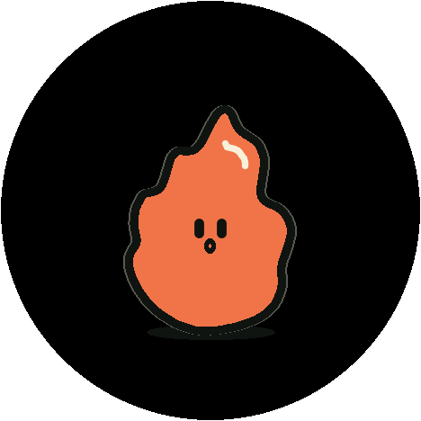
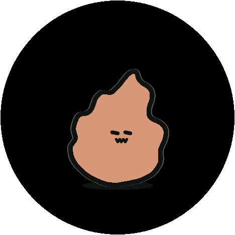
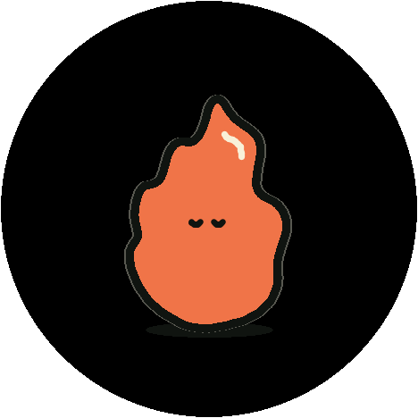
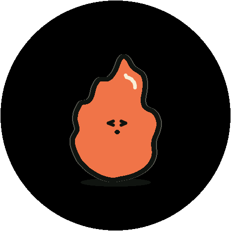
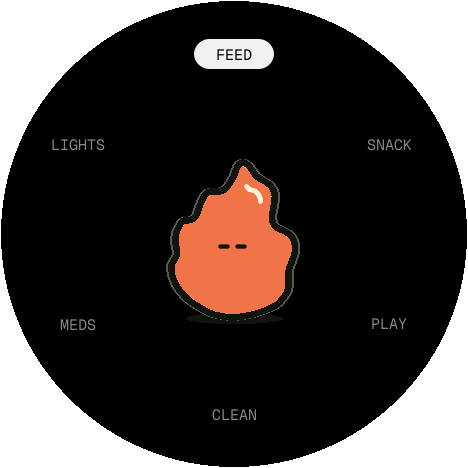
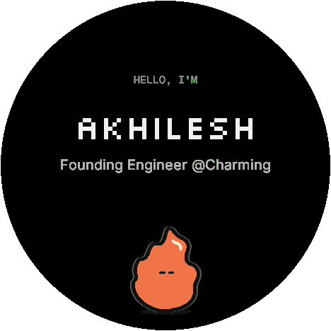
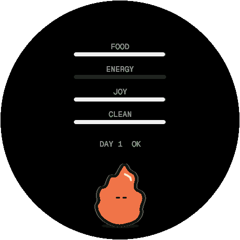
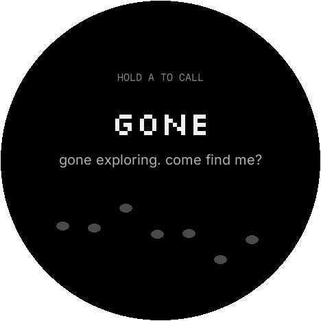

# Charming Badge Pet

A Tamagotchi for the WorkOS init() conference badge (M5Stack StopWatch, ESP32-S3). The pet is the Charming mascot, drawn live on the round AMOLED: it breathes, blinks, wobbles like a hand-drawn line, and always stands upright on real gravity when you turn the badge.

It's a real Tamagotchi with harsh rules. It gets hungry, makes messes, gets sick, throws fake tantrums, and runs away if you neglect it. It never dies, though: you can always call it back and earn its trust again.

<table>
  <tr>
    <td align="center"><br><sub>idle</sub></td>
    <td align="center"><br><sub>happy (just petted)</sub></td>
    <td align="center"><br><sub>hungry</sub></td>
    <td align="center"><br><sub>sick</sub></td>
    <td align="center"><br><sub>sleeping</sub></td>
  </tr>
  <tr>
    <td align="center"><br><sub>tantrum</sub></td>
    <td align="center"><br><sub>care menu</sub></td>
    <td align="center"><br><sub>name tag</sub></td>
    <td align="center"><br><sub>status</sub></td>
    <td align="center"><br><sub>ran away</sub></td>
  </tr>
</table>

<sub>All screenshots are real frames pulled off the badge over USB (`tools/screenshot.py`).</sub>

## Controls

| Input | What it does |
|---|---|
| **A** | Open the care menu. In the menu: next item |
| **B** | Show your name tag. In the menu: pick. Elsewhere: back |
| **Hold B** | Status: food, energy, joy, clean |
| **Hold A** | On the "gone" screen: call it back |
| **Hold A + B (3 s)** | Pause. Freezes its needs for up to 10 h a day, e.g. during a conference |
| **Tap the mascot** | Poke it |
| **Stroke the screen** | Pet it (it purrs) |
| **Rotate the badge** | It stays standing on real "down" |
| **Shake** | Makes it dizzy, and it doesn't like that |

The care menu has **FEED** (a meal), **SNACK**, **PLAY**, **CLEAN**, **MEDS** and **LIGHTS** (sleep or wake).

**PLAY** is a 10-second mini-game: tilt the badge to slide the mascot under falling sparks, and catch 3 to win.

## How the pet works

- **Needs drop in real time, even while the badge is off.** It catches up from the clock on every wake.
  - Food empties in about 4 h, joy in about 5 h, cleanliness in about 8 h.
  - Energy drains while it's awake and refills while it sleeps.
- **Meals leave a mess about an hour later.** Clean it up. Two messes left for an hour make it sick.
- **Sickness.** It gets sick from any stat sitting at zero for an hour, too many messes, or 3 snacks within 30 minutes (bellyache). Sickness gets worse every 3 h until you give it medicine.
- **Tantrums.** It sometimes throws a fake tantrum. Giving in spoils it, and then it does it more. Waiting 2 minutes and then being nice teaches it discipline.
- **Running away.** It leaves after 8 h of being sick with no care, or 4 h with every stat at zero.
  - Hold A to call it back.
  - It comes back grumpy. Win it back with 3 care sessions at least an hour apart, or 5 if it was gone for 2 days or more.
- **Sleep.** It sleeps on its own from 23:00 to 07:00. Waking it up at night makes it grumpy.
- **Growth.** Good care over days 3, 7 and 14 makes it grow.

All the tuning numbers live in [`firmware/badge-pet/src/pet/PetConfig.h`](firmware/badge-pet/src/pet/PetConfig.h).

## Flash it onto your badge

You need a Mac (Apple Silicon is fine), a USB-C data cable, and Homebrew.

```bash
scripts/setup.sh     # installs arduino-cli, the M5Stack core, M5Unified/M5GFX and a Python venv
scripts/backup.sh    # REQUIRED first: saves the whole 16 MB flash to backups/ and prints the partition table
scripts/flash.sh     # builds and uploads (refuses to run until a backup exists)
scripts/monitor.sh   # serial console
```

- **If the upload can't connect:** hold the badge's power button for about 2 s until the green LED turns on (download mode), then run `scripts/flash.sh` again. To get back out of download mode, hold power until the LED goes off, then press it once.
- **If the build fails with `bad CPU type in executable` for `ctags`:** Arduino ships an Intel-only `ctags`. On a Mac without Rosetta, build [arduino/ctags](https://github.com/arduino/ctags) natively and replace `~/Library/Arduino15/packages/builtin/tools/ctags/5.8-arduino11/ctags` with it. You also need to rename the `__unused__` macro in its sources to compile on recent macOS.

### Set the clock once

The conference firmware leaves the badge clock on UTC, which makes the pet think it's the middle of the night. Set it to local time:

```bash
tools/.venv/bin/python -I tools/serial_read.py "" 3 "T $(date '+%Y-%m-%d %H:%M')"
```

### Serial commands (115200 baud)

| Command | Effect |
|---|---|
| `T 2026-10-12 14:30` | Set the clock. Correcting the clock never counts as time passing |
| `S` | Print the pet's full state |
| `F 120` | Fast-forward 120 minutes (testing) |
| `G 1` / `X 2` | Jump to a scene / force an expression for 20 s (screenshots) |
| `P` | Dump the current frame (used by `tools/screenshot.py`) |
| `R YES` | Start over with a new pet |

## Your conference badge is safe

- The pet only stores its state in the chip's NVS settings area under its own `pet` namespace. It never mounts or formats the `ffat` partition that holds your attendee profile.
- The firmware is always built with the badge's original partition layout (`16M Flash (3MB APP/9.9MB FATFS)`). That means the WorkOS installer at https://workos.com/init/badge/install can still put the conference firmware back.
- You also have your own full flash backup in `backups/`.

## How it's built

| Path | What's inside |
|---|---|
| `firmware/badge-pet/src/pet/` | The pet simulation: pure C++ with no hardware code, tested on the Mac with simulated time |
| `firmware/badge-pet/src/render/` | The mascot renderer, the face, effects, and text in the Silkscreen, Inter and Geist Mono fonts |
| `firmware/badge-pet/src/input/` | Tap vs. stroke detection, shake detection, the button arbiter, and gravity from the accelerometer |
| `firmware/badge-pet/src/scenes/` | The screens: pet, menu, status, name tag, messages, gone, and the play mini-game |
| `firmware/badge-pet/src/store/` `power/` `app/` | Saving to NVS, the clock, dimming, deep sleep with a 15-minute wake, and wiring it all together |
| `tools/` | Converts the SVG outline to points, converts fonts, and grabs screenshots |
| `tests/` | Host unit tests: `make -C tests test` |

Rendering details:
- **The mascot is fully procedural.** The real Charming flame outline is sampled into 72 points that sit on springs.
- **Every frame:**
  - the outline is deformed for breathing, hops and flicker;
  - it gets a little "line boil" jitter, like hand-drawn animation;
  - it's rotated to match gravity;
  - it's filled with fast scanline fills into a sprite in the extra RAM.
- **Two frames are in flight at once:** core 1 draws the next frame while core 0 sends the previous one to the screen. That runs at about 50 fps.

Design docs: [spec](docs/superpowers/specs/2026-10-12-phase1-pet-design.md), [implementation plan](docs/superpowers/plans/2026-10-12-phase1-pet.md), [device checklist](docs/device-checklist.md).

## Roadmap

1. **The pet comes alive** (this release).
2. **Talk to it.** Push-to-talk voice through the badge's mic and speaker, plus a text chat. The badge already has the display hook for what the AI wants to show.
3. **It can do things.** It builds Charming apps and shows them as a QR code, and connects to your calendar, email and Slack.
4. **Wake word.** "hey Charming".

## Credits

- The mascot is the [Charming](https://charm.ing) mark.
- Fonts: [Silkscreen](https://github.com/googlefonts/silkscreen), [Inter](https://github.com/rsms/inter) and [Geist Mono](https://github.com/vercel/geist-font), all under the SIL Open Font License (see `tools/fonts/`).
- Built on [M5Unified](https://github.com/m5stack/M5Unified) and [M5GFX](https://github.com/m5stack/M5GFX).
